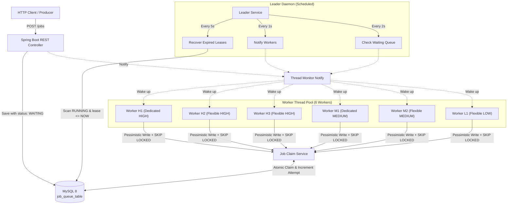
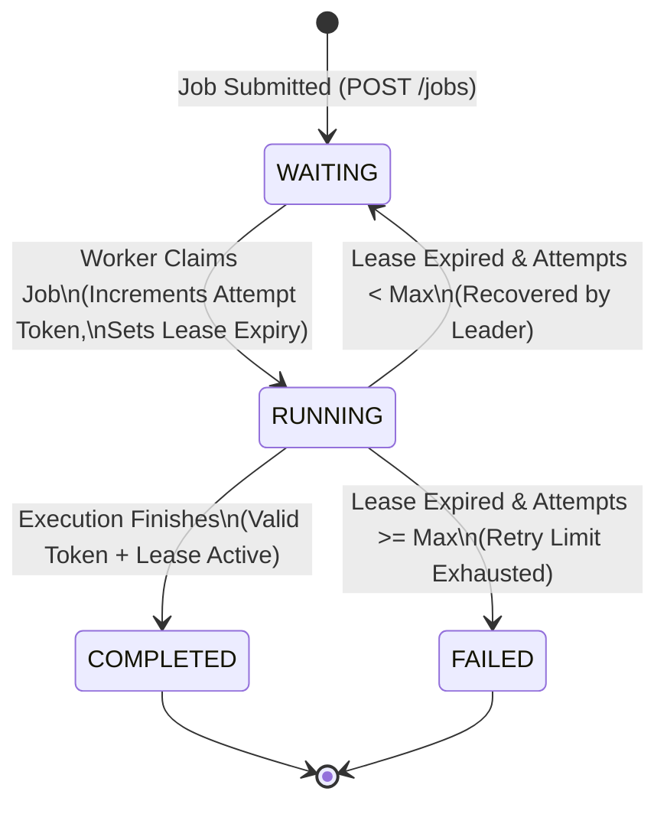

# ⚡ Dynamic Job Execution Engine

A resilient, database-backed concurrent job execution engine built with **Java 25** and **Spring Boot 4**. 

Rather than relying on in-memory queues or third-party message brokers, this project explores how to coordinate multi-worker concurrency directly on top of an RDBMS (MySQL 8). It addresses real-world concurrency challenges—such as worker contention, database row-locking overhead, zombie processes, and node crashes—using **priority-aware worker scheduling**, **pessimistic locking with `SKIP LOCKED`**, **lease-based recovery**, and **stale-worker fencing tokens**.

---

## 📑 Table of Contents

- [Motivation & Core Concepts](#-motivation--core-concepts)
- [Key Features](#-key-features)
- [System Architecture](#-system-architecture)
- [Worker Scheduling & Priority Model](#-worker-scheduling--priority-model)
- [Job Lifecycle](#-job-lifecycle)
- [Concurrency, Locking & Recovery Mechanics](#-concurrency-locking--recovery-mechanics)
- [Performance Optimization & Benchmarks](#-performance-optimization--benchmarks)
- [Technology Stack](#-technology-stack)
- [Getting Started](#-getting-started)
- [REST API Reference](#-rest-api-reference)
- [Verification & Failure Mode Analysis](#-verification--failure-mode-analysis)
- [Current Limitations & Roadmap](#-current-limitations--roadmap)
- [Author](#-author)

---

## 💡 Motivation & Core Concepts

In distributed backend systems, offloading asynchronous background work is common practice. While specialized messaging systems (RabbitMQ, Kafka, SQS) are frequently used, managing an external broker can introduce operational overhead and split-brain states between application state and message state.

Using a relational database as a persistent job queue is an attractive alternative, but it presents classic database concurrency challenges:
1. **Thundering Herd & Lock Contention:** Multiple workers querying the queue simultaneously can cause catastrophic lock waits and table scans.
2. **Priority Inversion & Worker Starvation:** Low-priority tasks can easily drown out high-priority work if queues are unscheduled.
3. **Crashed / Stalled Workers:** If a worker crashes mid-task, the job cannot stay locked indefinitely in a `RUNNING` state.
4. **The "Zombie Worker" Dilemma:** If a worker pauses (e.g., GC pause or network stall), its job might be reassigned to another worker. If the old worker wakes back up and completes its work, it must not corrupt the newer attempt's state.

This project implements and measures concrete engineering solutions for each of these problems directly inside Spring Boot and MySQL.

---

## ✨ Key Features

- **Concurrent Multi-Worker Pool:** Runs six dedicated and flexible worker threads processing workloads concurrently.
- **Priority-Aware Scheduling:** Supports `HIGH`, `MEDIUM`, and `LOW` priorities with custom queue-hopping policies to maximize throughput while guaranteeing high-priority execution.
- **Durable Database Queue:** All job states, scheduling metadata, timestamps, and attempt histories are persisted in MySQL 8.
- **Optimized Transactional Claiming:** Employs bounded JPA retrieval (`findFirst...`), a composite index on `(priority, current_status, created_at)`, and MySQL's row-level `FOR UPDATE SKIP LOCKED` to virtually eliminate lock waits.
- **Lease-Based Auto-Recovery:** A scheduled leader monitor automatically discovers jobs whose processing leases expired and puts them back into `WAITING` for a new worker to claim.
- **Stale-Worker Fencing Tokens:** Monotonically incrementing attempt counters prevent zombie workers from accidentally updating or completing a reassigned job.
- **Bounded Retry Limits:** Tracks retry counts and automatically transitions chronically failing jobs to `FAILED` status.
- **Comprehensive REST API:** Exposes endpoints to submit jobs, monitor queue progress, and inject test failure states.
- **Empirical Benchmarks:** Documented performance improvements showing an **11.6x reduction in claim query latency** and a **97%+ drop in database lock-wait times**.

---

## 🏛️ System Architecture



---

## 🧵 Worker Scheduling & Priority Model

The engine operates **six background worker threads**. Rather than using a naive global lock or strict single-queue ordering, workers follow distinct scheduling policies:

| Worker ID | Primary Preference | 1st Fallback | 2nd Fallback | Role & Scheduling Strategy |
| :--- | :--- | :--- | :--- | :--- |
| **H1** | `HIGH` | *None* | *None* | **Dedicated High-Priority Worker.** Never steals from other queues; stays reserved for urgent jobs. |
| **H2**, **H3** | `HIGH` | `MEDIUM` | `LOW` | **Flexible High-Priority Workers.** Prefers `HIGH`, but will pick up `MEDIUM` or `LOW` jobs if the high queue is empty. |
| **M1** | `MEDIUM` | *None* | *None* | **Dedicated Medium-Priority Worker.** Guaranteed execution slot for normal business logic. |
| **M2** | `MEDIUM` | `HIGH` | `LOW` | **Flexible Medium-Priority Worker.** Primarily services `MEDIUM`, backs up `HIGH`, and handles `LOW` as last resort. |
| **L1** | `LOW` | `HIGH` | `MEDIUM` | **Opportunistic Low-Priority Worker.** Prevents starvation of background tasks, but aids higher queues during traffic spikes. |

> **Note on Scheduling Semantics:**  
> This design implements *priority-aware scheduling with cooperative fallback*, not strict preemptive global ordering. A job already claimed and running on a worker will not be interrupted or preempted if a higher-priority job arrives mid-execution.

---

## 🔄 Job Lifecycle



### Stored Metadata per Job
Each record in `job_queue_table` tracks:
- `id`: Auto-generated unique identifier.
- `priority`: `HIGH`, `MEDIUM`, or `LOW`.
- `current_status`: `WAITING`, `RUNNING`, `COMPLETED`, or `FAILED`.
- `work_duration_ms`: Configured simulated processing duration.
- `attempt_count`: Total claim attempts made so far (acts as the fencing token).
- `max_attempts`: Maximum allowable attempts (default: 3).
- `created_at`: Job insertion timestamp (used for FIFO within the same priority).
- `work_started_at`: Timestamp when current attempt began.
- `lease_expires_at`: Absolute timestamp after which the current attempt is considered dead.

---

## 🔒 Concurrency, Locking & Recovery Mechanics

### 1. Atomic Job Claiming with `SKIP LOCKED`
In a high-concurrency database queue, multiple workers executing `SELECT ... FOR UPDATE` without skip semantics can result in lock contention: workers block on locked rows or wait behind long-running claims.

To eliminate this bottleneck, this project uses:
```java
@Lock(LockModeType.PESSIMISTIC_WRITE)
@QueryHints({
    @QueryHint(name = "jakarta.persistence.lock.timeout", value = "-2") // MySQL SKIP LOCKED
})
Optional<JobQueue> findFirstByPriorityAndCurrentStatusOrderByCreatedAtAsc(
    JobPriority priority,
    JobStatus currentStatus
);
```
- **Bounded retrieval:** `findFirstBy...` limits the query result to 1 row.
- **Composite Index:** An index on `(priority, current_status, created_at)` allows MySQL to jump directly to eligible `WAITING` rows.
- **`SKIP LOCKED`:** If another worker is currently evaluating or claiming row #1, subsequent workers immediately skip past it and lock row #2 without blocking.

### 2. Lease-Based Crash Recovery
Every claim assigns an expiration lease:
$$\text{leaseExpiresAt} = \text{now} + \text{workDurationMs} + 10{,}000\text{ ms (grace period)}$$

If a worker node crashes, experiences an unhandled exception, or suffers a network partition, the scheduled leader daemon detects the expired lease:
```java
@Scheduled(fixedDelay = 5000)
public void manageFailures() {
    int recovered = jobClaimService.recoverExpiredJobs();
    if (recovered > 0) {
        threadService.notifyWorkers();
    }
}
```
If `attemptCount < maxAttempts`, the status resets to `WAITING` so another worker can retry it. If retries are exhausted, the status is set to `FAILED`.

### 3. Stale-Worker Fencing Tokens
Consider this distributed edge case:
1. Worker A claims Job #42 (`attemptCount = 1`).
2. Worker A experiences an unexpected 20-second thread stall or GC pause.
3. The lease expires; Leader recovers Job #42 and resets it to `WAITING`.
4. Worker B claims Job #42 (`attemptCount = 2`) and begins processing.
5. Worker A wakes back up and tries to mark Job #42 as `COMPLETED`.

To prevent Worker A from overwriting Worker B's progress, `completeJob(jobId, attemptToken)` validates:
- `job.getAttemptCount() == attemptToken`
- `job.getLeaseExpiresAt().isAfter(LocalDateTime.now())`

Because Worker A's token (`1`) no longer matches the database (`2`), its completion attempt is rejected.

### 4. Delivery Semantics: At-Least-Once
Because crashes can happen after a worker performs real-world side effects but before recording completion in MySQL, this engine provides **at-least-once execution semantics**. External operations executed within jobs should be designed to be idempotent.

---

## 📊 Performance Optimization & Benchmarks

### Optimization Summary
- **Before Optimization:** Unindexed scan over `job_queue_table` with multi-row retrieval and standard pessimistic write locking. Competing workers repeatedly locked each other out, triggering table scans and file-sort operations.
- **After Optimization:** Added composite index `idx_queue_claim (priority, current_status, created_at)`, restricted query results to a single row, and enabled `FOR UPDATE SKIP LOCKED`.

### Benchmark Results
The following measurements were captured on a local benchmark run with 8 concurrent HTTP submission clients against a 6-worker pool. Workload priority distribution: 40% HIGH (50 ms), 40% MEDIUM (100 ms), 20% LOW (150 ms).

| Metric | 500 Jobs: Before | 500 Jobs: After | 1,000 Jobs: Before | 1,000 Jobs: After | Improvement Impact |
| :--- | :---: | :---: | :---: | :---: | :---: |
| **Submission Rate** | 437.19 req/s | **481.21 req/s** | 475.26 req/s | **516.31 req/s** | +9% to +10% faster ingestion |
| **Submission P95 Latency** | 34.39 ms | **26.78 ms** | 31.88 ms | **25.29 ms** | ~21% reduction |
| **Completion Throughput** | 41.16 jobs/s | **42.76 jobs/s** | 39.27 jobs/s | **44.00 jobs/s** | Steady concurrent worker saturation |
| **Median End-to-End Latency** | 4.66 s | **4.06 s** | 9.92 s | **8.34 s** | Lower total queue wait time |
| **Cumulative Lock-Wait Time** | 7.66 s | **0.20 s** | 20.34 s | **0.49 s** | **97.4% – 97.6% drop in lock contention** |
| **Avg. Claim Query Latency** | 5.09 ms | **0.438 ms** | — | — | **~11.6x faster query time** |

### Benchmark Takeaways
1. **Contention Eliminated:** The single most dramatic win is cumulative lock-wait time dropping from **20.34 seconds down to 0.49 seconds** under a 1,000-job load.
2. **Predictable Scalability:** Removing filesort operations and index locks allows the MySQL engine to process worker claims in sub-millisecond time.

---

## 🛠️ Technology Stack

| Technology | Role / Purpose |
| :--- | :--- |
| **Java 25** | Core language, modern concurrency primitives, and thread coordination |
| **Spring Boot 4.1.1** | Application framework, scheduling (`@Scheduled`), and REST APIs |
| **Spring Data JPA / Hibernate** | Entity mappings, repository abstractions, and lock hints |
| **MySQL 8** | Persistent job storage, row-level locking, and transactional indexing |
| **Maven** | Build management and dependency resolution |
| **Python** | Concurrency benchmark runner and metric aggregation scripts |

---

## 🚀 Getting Started

### Prerequisites
- **Java 25** (or a compatible JDK 21+ supported by your environment)
- **Maven 3.9+**
- **MySQL 8.0+** running locally or accessible over the network

### 1. Clone the Repository
```bash
git clone https://github.com/Akhil-kotipali/dynamic-job-administration-system.git
cd dynamic-job-administration-system
```

### 2. Configure MySQL Database
Log into MySQL and create the database:
```sql
CREATE DATABASE dynamic_job_system;
```

Update your connection credentials in `src/main/resources/application.properties` (or supply them via environment variables):
```properties
spring.datasource.url=jdbc:mysql://localhost:3306/dynamic_job_system
spring.datasource.username=${DB_USERNAME:root}
spring.datasource.password=${DB_PASSWORD:secret}
spring.jpa.hibernate.ddl-auto=update
```

### 3. Build the Project
```bash
./mvnw clean package
```

### 4. Run the Engine
Run directly via the Maven plugin:
```bash
./mvnw spring-boot:run
```
Or run the compiled JAR:
```bash
java -jar target/dynamicjobsystem-0.0.1-SNAPSHOT.jar
```
The server will start on `http://localhost:8080`.

---

## 🔌 REST API Reference

### 1. Submit a New Job
```bash
POST /jobs?priority=HIGH&workDurationMs=3000&maxAttempts=3
```
**Example:**
```bash
curl -X POST "http://localhost:8080/jobs?priority=HIGH&workDurationMs=3000&maxAttempts=3"
```
*Response (`200 OK`):*
```json
{
  "id": 1,
  "createdAt": "2026-10-23T09:30:00",
  "currentStatus": "WAITING",
  "priority": "HIGH",
  "workDurationMs": 3000,
  "attemptCount": 0,
  "maxAttempts": 3,
  "workStartedAt": null,
  "leaseExpiresAt": null
}
```

### 2. Retrieve Job by ID
```bash
curl -X GET "http://localhost:8080/jobs/1"
```

### 3. List All Jobs
```bash
curl -X GET "http://localhost:8080/jobs"
```

### 4. Filter by Status
```bash
curl -X GET "http://localhost:8080/jobs/status/COMPLETED"
```
*Supported statuses:* `WAITING`, `RUNNING`, `COMPLETED`, `FAILED`.

### 5. Filter by Priority
```bash
curl -X GET "http://localhost:8080/jobs/priority/HIGH"
```
*Supported priorities:* `HIGH`, `MEDIUM`, `LOW`.

---

### 🧪 Diagnostic & Testing Endpoints
The application includes specialized test endpoints under `/jobs/test` to inspect edge cases and recovery behavior:

| Endpoint | Method | Description |
| :--- | :---: | :--- |
| `/jobs/test/create-custom` | `POST` | Seeds a job with custom `status`, `attemptCount`, `maxAttempts`, and `leaseOffsetMs` (e.g. create a simulated pre-expired `RUNNING` job). |
| `/jobs/test/complete` | `POST` | Attempts to complete a job with a specific `attemptToken` (verifies stale worker rejection). |
| `/jobs/test/recover` | `POST` | Manually triggers the lease recovery loop and returns the number of reclaimed jobs. |

---

## 🔬 Verification & Failure Mode Analysis

The system was verified through end-to-end local runs and failure injection:
- **Zero Duplicate Claims:** Verified that concurrent worker threads never successfully claim the same waiting job row.
- **Priority Bias Validation:** Confirmed that `HIGH` priority jobs consistently achieve lower queue wait times under mixed load.
- **Lease Expiry Recovery:** Injected dead worker scenarios where running jobs with expired leases were successfully re-queued and completed by another worker.
- **Fencing Protection:** Simulated lagging workers attempting to complete jobs using stale tokens; the engine correctly rejected invalid transitions.
- **Deadlock Resilience:** Validated recovery and non-blocking operation during burst job submissions.

---

## 📌 Current Limitations & Roadmap

### Current Limitations
- **Single-Node Worker Pool:** The current implementation schedules threads within a single JVM process. While the MySQL schema is multi-instance capable, distributed cluster leadership is not yet coordinated via distributed locks (e.g., ShedLock or Redis lock).
- **Non-Preemptive:** Running jobs run to completion and are not interrupted by incoming higher-priority jobs.
- **At-Least-Once Delivery:** Applications running side effects must implement idempotency keys externally.

### Future Roadmap
- [ ] **Configurable Worker Pool:** Move worker sizing and thread mappings to `application.properties`.
- [ ] **Distributed Multi-Node Support:** Integrate distributed leader election for the recovery daemon.
- [ ] **Observability & Metrics:** Export Micrometer metrics for queue depth, worker utilization, claim latency, and retry rates to Prometheus/Grafana.
- [ ] **Automated Integration Test Suite:** Add Testcontainers-based MySQL integration tests to CI/CD.

---

## 👤 Author

**Akhil Kotipali**  
GitHub: [@Akhil-kotipali](https://github.com/Akhil-kotipali)
